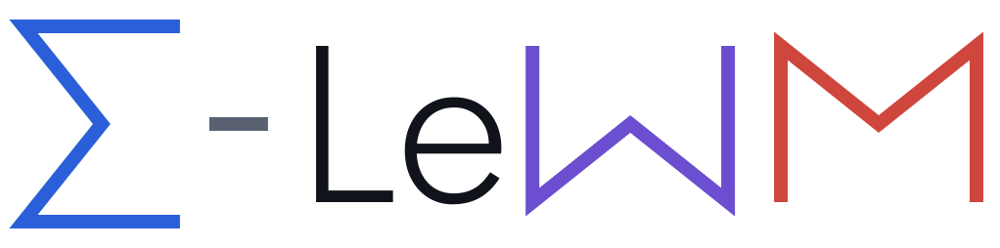
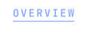
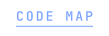
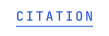
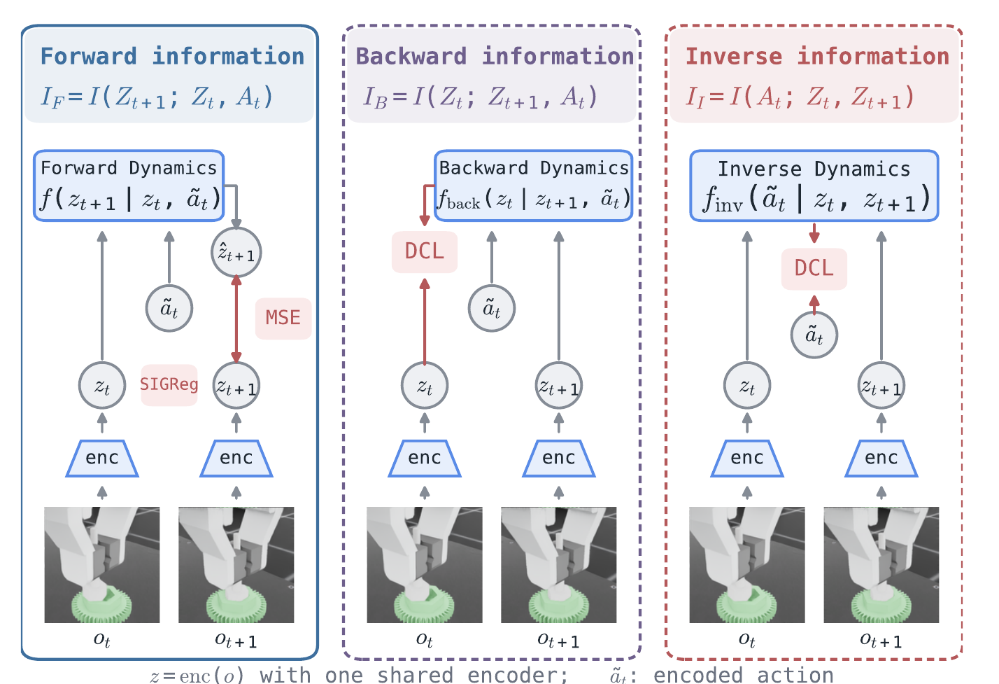

<div align="center">
  <picture>
    <source media="(prefers-color-scheme: dark)" srcset="assets/sigma-lewm-dark.svg">
    
  </picture>

  <h1>Σ-LeWM: Learning World Models via S-Information for Robot Control</h1>

  <p>
    <a href="https://zuxinrui.github.io/">Xinrui Zu</a>
    &nbsp;&middot;&nbsp; <a href="https://scholar.google.com/citations?user=UHWkDfkAAAAJ&hl=en">Michael Przystupa</a>
    &nbsp;&middot;&nbsp; <a href="https://yangzhao-666.github.io/">Zhao Yang</a>
    &nbsp;&middot;&nbsp; <a href="https://sjyucnel.github.io/">Shujian Yu</a>
    &nbsp;&middot;&nbsp; <a href="https://kevin-luck.com/">Kevin Sebastian Luck</a>
  </p>
  <p>Vrije Universiteit Amsterdam, The Netherlands</p>

  <p>
    &nbsp;
    &nbsp;
    <a href="https://zuxinrui.github.io/sigma-lewm/"></a>&nbsp;
    <a href="https://huggingface.co/zuxinrui/sigma-lewm"></a>&nbsp;
  </p>
  
  <p>
    <a href="#overview"><picture><source media="(prefers-color-scheme: dark)" srcset="assets/nav/overview-dark.svg"></picture></a>
    <a href="#installation"><picture><source media="(prefers-color-scheme: dark)" srcset="assets/nav/installation-dark.svg"></picture></a>
    <a href="#prepare-data-and-checkpoints"><picture><source media="(prefers-color-scheme: dark)" srcset="assets/nav/data-dark.svg"></picture></a>
    <a href="#run-experiments"><picture><source media="(prefers-color-scheme: dark)" srcset="assets/nav/experiments-dark.svg"></picture></a>
    <a href="docs/ARCHITECTURE.md"><picture><source media="(prefers-color-scheme: dark)" srcset="assets/nav/code-map-dark.svg"></picture></a>
    <a href="#citation"><picture><source media="(prefers-color-scheme: dark)" srcset="assets/nav/citation-dark.svg"></picture></a>
  </p>
  
</div>

## Overview

Σ-LeWM is a decoder-free latent world model. It is trained not only to predict the
*next* latent state, but also to explain the *current* state from where it lands and
to recover the *action* that connects them. Together the three objectives maximise
the S-information $\Sigma$ of the transition $(Z_t, A_t, Z_{t+1})$.

LeWorldModel (LeWM) learns a latent transition $f(z_t, a_t) \to z_{t+1}$ without a
decoder. Σ-LeWM adds two auxiliary predictors, used only during training, so that
every variable of the transition is predictable from the other two.

| Direction | Loss | Information term | Role |
| --- | --- | --- | --- |
| Forward | MSE + SIGReg | $I_F = I(Z_{t+1}; Z_t, A_t)$ | Predict the next latent from the current latent and the action. The standard LeWM objective, and the only predictor used at test time. |
| Backward | DCL | $I_B = I(Z_t; Z_{t+1}, A_t)$ | Explain the current latent from where the action lands. |
| Inverse | DCL | $I_I = I(A_t; Z_t, Z_{t+1})$ | Recover the action from two consecutive latents, so the embedding keeps what the action changed. |

$$I_F + I_B + I_I = \mathrm{TC}(Z_t, A_t, Z_{t+1}) + \mathrm{DTC}(Z_t, A_t, Z_{t+1}) = \Sigma(Z_t, A_t, Z_{t+1})$$

The sum of the three directional terms is the total correlation plus the dual total
correlation: the S-information, written $\Sigma$. Hence the name.

<p align="center">
  
</p>

One shared encoder, three predictors. Forward dynamics is trained with the LeWM loss;
backward and inverse dynamics with the decoupled contrastive loss (DCL). At test time
only forward dynamics is used, so planning is identical to LeWM: CEM in latent space.

This repository contains code and configurations only. Datasets, checkpoints, logs
and measurements are not included; every command below starts a new run.

## Read the method

Core code lives in the `slewm` package, separate from experiment orchestration scripts.

- Model and rollout: [`slewm/models/world_model.py`](slewm/models/world_model.py).
- Forward loss: [`slewm/objectives/forward.py`](slewm/objectives/forward.py).
- Backward and inverse: [`slewm/objectives/contrastive.py`](slewm/objectives/contrastive.py).
- Combined objective: [`slewm/objectives/triadic.py`](slewm/objectives/triadic.py).

See the [code map](docs/ARCHITECTURE.md) for task constraints, baselines, and distributed
training.

## Installation

Python 3.10 on Linux with a CUDA GPU.

```bash
python3.10 -m venv .venv
source .venv/bin/activate
python -m pip install -r requirements.txt
python -m pip install -e .
```

Isaac Lab tasks (Gear, Franka) need a separate simulator installation and task
assets, which are not distributed here; [docs/EVALUATION.md](docs/EVALUATION.md) has a
minimal Isaac install and the evaluation protocol for every task.

## Prepare data and checkpoints

```bash
export STABLEWM_HOME=/path/to/stablewm
export SLEWM_DATA_ROOT=/path/to/gear-franka-data
export SLEWM_CHECKPOINT_ROOT=/path/to/gear-franka-checkpoints
export ISAAC_PYTHON=/path/to/isaac-environment/bin/python
```

Place benchmark datasets and checkpoints under `STABLEWM_HOME`. Checkpoints for
the four standard tasks are hosted on
[Hugging Face](https://huggingface.co/zuxinrui/sigma-lewm):

```bash
hf download zuxinrui/sigma-lewm --local-dir $STABLEWM_HOME/checkpoints/sigma-lewm
slewm eval --task pusht --checkpoint sigma-lewm/pusht/weights.pt --horizon 5 --cem 30 --execute
```

Dataset filenames and splits are set in `config/`. External repository versions are
pinned in `docs/external_repos.lock.json`.

## Run experiments

Commands print the invocation first. Add `--execute` to launch it.

```bash
# Original LeWM objective
slewm train --task pusht --arm lewm --epochs 10

# Full backward + inverse objective; the A0-A8 recipes assume two GPUs
slewm train --task pusht --arm A7 --epochs 15

# OGBench-Scene (python scripts/prep_ogb_scene.py first): lewm, A7, acmtm or smwm
slewm train --task scene --arm A7 --epochs 10

# Gear/Franka: l0, c0, acmtm or smwm
slewm train --task gear --arm c0 --epochs 30

# Stock CEM checkpoint evaluation
slewm eval --task pusht --checkpoint /path/to/weights.pt --horizon 5 --cem 30

# Synthetic exact-MI experiment (CPU, no data needed)
slewm toy --name exact --execute
```

`slewm list` prints every experiment family; the
[experiment index](docs/EXPERIMENTS.md) links each one to its entry points. For
Gear/Franka, `--epochs` sets a fixed budget and disables early stopping.

## Check the repository

```bash
python -m pytest -q
slewm audit
```

The tests run on CPU without datasets. The audit checks that every registered
entry point exists and parses. Some orchestration scripts under `scripts/` were
written for a specific workstation layout and may need path arguments adjusted.

## License

LeWM's license is retained in `LICENSE`. Third-party datasets and simulator
assets carry their own licenses.

## Citation

```bibtex
@article{sigma-lewm2027,
  title  = {{$\Sigma$}-LeWM: Learning World Models via S-Information for Robot Control},
  author = {Zu, Xinrui and Przystupa, Michael and Yang, Zhao and Yu, Shujian and Luck, Kevin Sebastian},
  year   = {2027}
}
```
